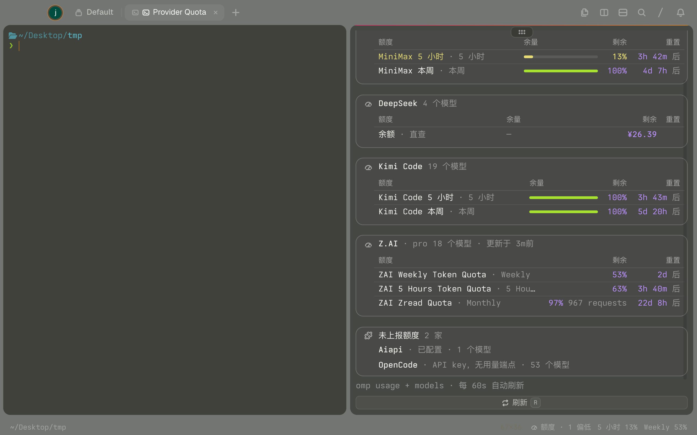
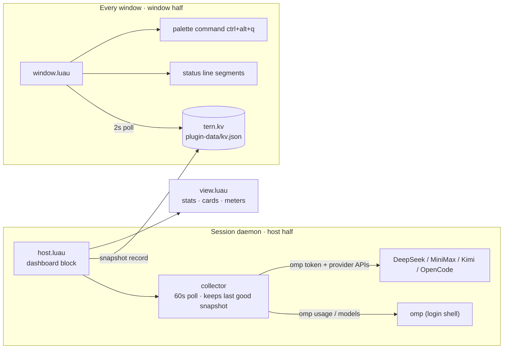

<div align="center">

# Provider Quota

**A provider-quota dashboard for the [Tern](https://stencil.so/tern) terminal** — see every configured model provider's usage at a glance, and pick the one with the most headroom.

[简体中文](README.zh-CN.md) · English



  

</div>

## What you get

- **Full inventory** — every provider omp has credentials for shows up, not just the ones omp can query usage for: quota cards, a balance row, or an "unreported" entry with the reason.
- **Urgency sorting + recommendation** — the most-consumed provider sits on top; the one with the most remaining carries a **Recommended** tag.
- **Live status line** — a compact segment (`Quota · OK · Weekly 53% · 1 login needed`) that escalates through warning/exhausted tones as windows drain, click to open the dashboard.
- **Direct-query adapters** — for providers omp can't report, the plugin calls the provider's own documented API with the key omp already stores. Keys only ever live in memory and request headers — never on disk, never in logs.

| Provider | Source | Shows |
| --- | --- | --- |
| Z.AI / Anthropic / OpenAI Codex / … | `omp usage --json` | per-window meters, reset countdowns |
| DeepSeek | `GET api.deepseek.com/user/balance` | balance (¥) |
| MiniMax CN | `GET api.minimaxi.com/v1/token_plan/remains` | 5-hour / weekly meters |
| Moonshot (Kimi platform; key may be a Kimi Code key) | `GET api.kimi.com/coding/v1/usages`, platform-key fallback `api.moonshot.ai/v1/usages` | 5-hour / weekly / monthly meters |
| OpenCode Go | `GET opencode.ai/zen/go/v1/usage` | rolling / weekly / monthly meters |
| anything else | `omp models --json` catalog | "unreported" row + model count |

## Install

```sh
tern plugin install github.com/amuluze/provider-quota
```

Update to the latest version:

```sh
tern plugin install github.com/amuluze/provider-quota --force
```

Development mode (edits apply on save):

```sh
git clone https://github.com/amuluze/provider-quota && tern plugin link ./provider-quota
```

## Usage

### Opening the dashboard

| Way | How |
| --- | --- |
| Keyboard | `ctrl+alt+q` |
| Command palette | "打开额度面板" |
| Status line | click any of the plugin's segments |
| As a plain block | palette → "New Provider Quota block" |

The dashboard opens **split below the focused pane**; opening it again focuses the existing panel instead of stacking another one. The plain-block route ignores that placement and creates the block wherever new blocks go.

### Reading the panel

- **Stats strip** — `已配置 configured / 正常 OK / 偏低 low / 耗尽 exhausted / 需登录 login needed`, counted live per **provider** (a provider's several quota windows land in the bucket of its tightest one).
- **Provider cards**, most urgent first. Each row is one quota window: remaining meter, percent, usage count, reset countdown. The card tagged **推荐** is where the most headroom is right now.
- **余额 · 直查 rows** — money balances fetched straight from the provider API.
- **未上报额度 card** — configured providers without a usable usage endpoint, with model counts; when a direct query is rejected upstream you see why (e.g. OpenCode "key 已过期").
- **需要重新登录 card** — OAuth credentials that stopped refreshing, with the provider's error. Fix it in the terminal, press `r`, the card clears itself.

### Status line

Off by default — run **status bar on** from the palette. The plugin then shows a compact summary plus the tightest windows from **two different providers** (one slot per provider, e.g. `Z.AI 5 Hours 40% · MiniMax 本周 100%`). Fully exhausted windows yield their slot to live ones and are counted in the summary (`额度 · 1 耗尽`, red). Every segment opens the dashboard on click.

### Refresh

- `r` in the panel, or the Refresh button — immediate, and it first runs `omp usage invalidate`: omp keeps serving cached usage reports that can be minutes old, so a manual refresh always shows what the providers report right now.
- Otherwise every 60 s, counted from each refresh's **start**, so a slow omp never stretches the cycle. A failed refresh keeps the last good snapshot, shows a banner with the reason, and the summary gains a "（旧）" marker. Stale provider reports (older than 10 min) get a warning tint on their "updated" line.

### Typical loop

omp slows down or hits a limit → glance at the status line → open the dashboard (`ctrl+alt+q`) → send the next task to the **Recommended** provider.

## How it works



`host.luau` runs omp through your login shell (`$SHELL -l -c`) so provider API keys living in shell rc files are visible; the `window.luau` half only reads the small published record.

## Configuration

| Variable | Meaning |
| --- | --- |
| `TERN_QUOTA_BIN` | Path to the omp binary; defaults to `~/.local/bin/omp`, Tern's bundled omp, then `PATH` |

Set it for the GUI-launched daemon (macOS):

```sh
launchctl setenv TERN_QUOTA_BIN /path/to/omp
```

## Layout

| File | Role |
| --- | --- |
| `plugin.toml` | manifest: id, entries, block declaration |
| `usage.luau` | pure functions: normalize + merge, severity, durations, status summary |
| `balances.luau` | direct-query adapters: DeepSeek / MiniMax CN / Moonshot / OpenCode Go |
| `collector.luau` | polling loop: 60 s interval, timeout lease, keeps last good snapshot |
| `view.luau` | pure rendering: snapshot → native nodes (stats / cards / meters) |
| `host.luau` | host half: block, login-shell omp, token cache, balance enrichment, failing-URL backoff |
| `window.luau` | window half: palette command, status segments, kv change poll |

Host and window halves share the snapshot through `tern.kv` (`<state>/plugin-data/provider-quota/kv.json`).

---

Built as a [Tern plugin](https://docs.stencil.so/tern/) in Luau (`--!strict` for pure modules). Installing a Tern plugin means trusting it — read the source, it's ~700 lines.
