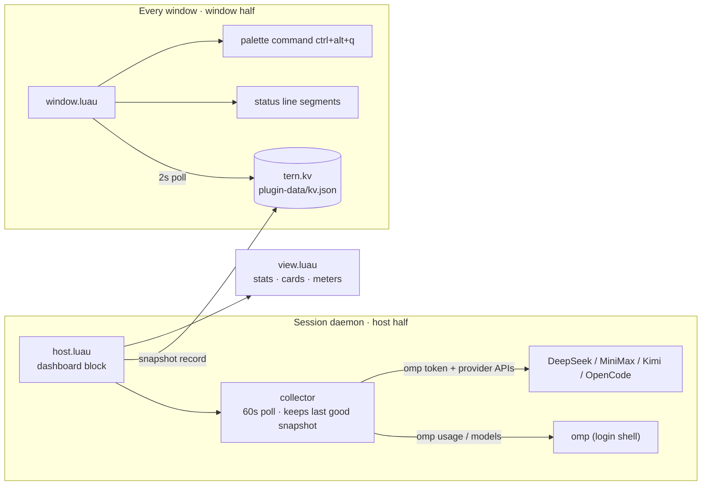

<div align="center">

# Provider Quota

**A provider-quota dashboard for the [Tern](https://stencil.so/tern) terminal** — see every configured model provider's usage at a glance, and pick the one with the most headroom.

[简体中文](README.zh-CN.md) · English


  

</div>

## What you get

- **Full inventory** — every provider omp has credentials for shows up, not just the ones omp can query usage for: quota cards, a balance row, or an "unreported" entry with the reason.
- **Urgency sorting + recommendation** — the most-consumed provider sits on top; the one with the most remaining carries a **Recommended** tag.
- **Live status line** — a compact segment (`Quota · OK · Weekly 53% · 1 login needed`) that escalates through warning/exhausted tones as windows drain, click to open the dashboard.
- **Direct-query adapters** — for providers omp can't report, the plugin calls the provider's own documented API with the key omp already stores. Keys only ever live in memory and request headers — never on disk, never in logs.

| Provider | Source | Shows |
| --- | --- | --- |
| Z.AI / Anthropic / OpenAI Codex / … | `omp usage --json` | per-window meters, reset countdowns |
| DeepSeek | `GET api.deepseek.com/user/balance` | balance (¥) |
| MiniMax CN | `GET api.minimaxi.com/v1/token_plan/remains` | 5-hour / weekly meters |
| Kimi Code | `GET api.kimi.com/coding/v1/usages` | 5-hour / weekly / monthly meters |
| OpenCode Go | `GET opencode.ai/zen/go/v1/usage` | rolling / weekly / monthly meters |
| anything else | `omp models --json` catalog | "unreported" row + model count |

## Install

```sh
tern plugin install github.com/amuluze/provider-quota
```

Update to the latest version:

```sh
tern plugin install github.com/amuluze/provider-quota --force
```

Development mode (edits apply on save):

```sh
git clone https://github.com/amuluze/provider-quota && tern plugin link ./provider-quota
```

## Usage

| Action | How |
| --- | --- |
| Open the dashboard | `ctrl+alt+q`, palette → "打开额度面板", or the status-line segment |
| Manual refresh | press `r` in the panel, or the Refresh button |
| Auto refresh | every 60 s; on failure the last good snapshot stays, with the reason |
| Status line | off by default — run "status bar on" from the palette |

The dashboard opens as a **split beside the focused pane** and is reused across opens.

## How it works



`host.luau` runs omp through your login shell (`$SHELL -l -c`) so provider API keys living in shell rc files are visible; the `window.luau` half only reads the small published record.

## Configuration

| Variable | Meaning |
| --- | --- |
| `TERN_QUOTA_BIN` | Path to the omp binary; defaults to `~/.local/bin/omp`, Tern's bundled omp, then `PATH` |

Set it for the GUI-launched daemon (macOS):

```sh
launchctl setenv TERN_QUOTA_BIN /path/to/omp
```

## Troubleshooting

| Symptom | Fix |
| --- | --- |
| A provider is missing | omp reads API keys from env vars the GUI daemon can't see; this plugin already spawns omp via your login shell. Keys in interactive-only rc files (`.zshrc`) still won't show — move them to `~/.zshenv` or `omp auth import` them into the credential store |
| "无法启动 omp" in the panel | daemon PATH lacks omp — set `TERN_QUOTA_BIN`, then `tern plugin reload` |
| No status segments | the status bar is hidden by default — run "status bar on" from the palette |
| OpenCode shows "key expired" | the Go subscription lapsed; resubscribe or create a new key in the OpenCode console (signing in again does not renew keys) |
| Plugin logs | start the daemon with `STENCIL_LOG=warn,stencil=info,tern::plugin=debug` |

## Layout

| File | Role |
| --- | --- |
| `plugin.toml` | manifest: id, entries, block declaration |
| `usage.luau` | pure functions: normalize + merge, severity, durations, status summary |
| `balances.luau` | direct-query adapters: DeepSeek / MiniMax CN / Kimi Code / OpenCode Go |
| `collector.luau` | polling loop: 60 s interval, timeout lease, keeps last good snapshot |
| `view.luau` | pure rendering: snapshot → native nodes (stats / cards / meters) |
| `host.luau` | host half: block, login-shell omp, token cache, balance enrichment |
| `window.luau` | window half: palette command, status segments, kv change poll |

Host and window halves share the snapshot through `tern.kv` (`<state>/plugin-data/provider-quota/kv.json`).

---

Built as a [Tern plugin](https://docs.stencil.so/tern/) in Luau (`--!strict` for pure modules). Installing a Tern plugin means trusting it — read the source, it's ~700 lines.
