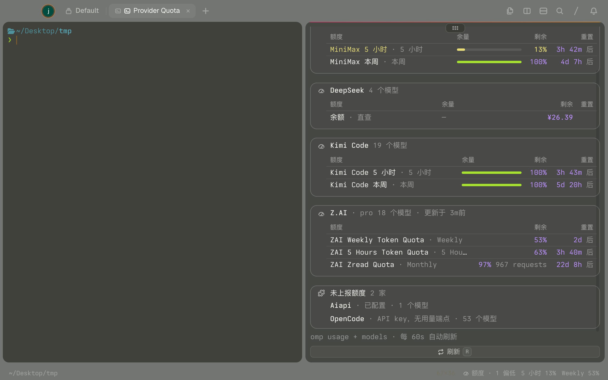
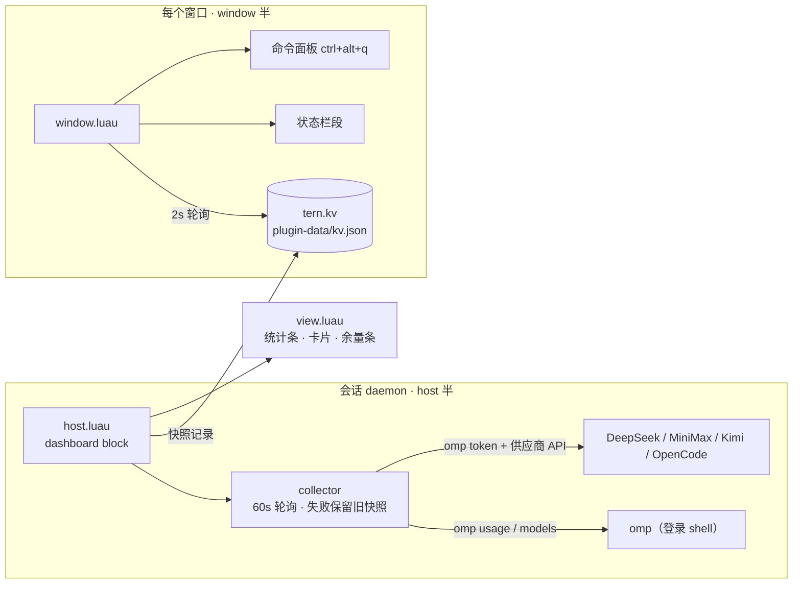

<div align="center">

# Provider Quota

**[Tern](https://stencil.so/tern) 终端的供应商额度面板**——一眼看清所有已配置模型供应商的用量，按余量挑合适的干活。

简体中文 · [English](README.md)



  

</div>

## 能看到什么

- **供应商全景**——omp 存了凭据的供应商全部出现，不只是 omp 能查用量的那几家：有额度卡片、余额行，或带原因的「未上报」条目。
- **紧急排序 + 推荐**——消耗最多的供应商排最上；余量最足的带 **推荐** 标记。
- **状态栏常驻**——紧凑段（`额度 · 正常 · Weekly 53% · 1 需登录`），随窗口消耗自动升级 警告/耗尽 色调，点击打开面板。
- **直查适配器**——omp 查不到用量的供应商，用 omp 已存的 key 调官方文档接口。密钥只存在于内存与请求头——不落盘、不进日志。

| 供应商 | 数据源 | 展示 |
| --- | --- | --- |
| Z.AI / Anthropic / OpenAI Codex / … | `omp usage --json` | 各窗口余量条、重置倒计时 |
| DeepSeek | `GET api.deepseek.com/user/balance` | 余额（¥） |
| MiniMax CN | `GET api.minimaxi.com/v1/token_plan/remains` | 5 小时 / 本周余量 |
| Kimi Code | `GET api.kimi.com/coding/v1/usages` | 5 小时 / 本周 / 本月余量 |
| OpenCode Go | `GET opencode.ai/zen/go/v1/usage` | rolling / weekly / monthly 余量 |
| 其他 | `omp models --json` 目录 | 「未上报」行 + 模型数 |

## 安装

```sh
tern plugin install github.com/amuluze/provider-quota
```

更新到最新版：

```sh
tern plugin install github.com/amuluze/provider-quota --force
```

开发模式（改动即时生效）：

```sh
git clone https://github.com/amuluze/provider-quota && tern plugin link ./provider-quota
```

## 使用

### 打开面板

| 方式 | 操作 |
| --- | --- |
| 快捷键 | `ctrl+alt+q` |
| 命令面板 | 搜「打开额度面板」 |
| 状态栏 | 点击插件的任意状态栏段 |
| 纯 block 方式 | 命令面板搜「New Provider Quota block」 |

面板在**焦点 pane 下方拆分**打开；重复打开会聚焦已有面板，不会堆叠。纯 block 方式不受该落位约束，按新 block 默认位置创建。

### 读懂面板

- **统计条**——`已配置 / 正常 / 偏低 / 耗尽 / 需登录`，实时计数，按**供应商**记（同一家的多个额度窗口归到该家最紧的那一档）。
- **供应商卡片**，最紧急的排最上。每行是一个额度窗口：余量条、剩余百分比、用量计数、重置倒计时。带 **推荐** 标记的卡片就是当前余量最足、适合接着干活的那家。
- **余额 · 直查 行**——直连供应商 API 查到的资金余额。
- **未上报额度 卡片**——没有可用用量端点的已配置供应商（附模型数）；直查被上游拒绝时会显示原因（如 OpenCode「key 已过期」）。
- **需要重新登录 卡片**——刷新失败的 OAuth 凭据，附供应商报错。在终端重新登录后按 `r`，卡片自动消失。

### 状态栏

默认隐藏——命令面板执行 **status bar on**。插件随后显示一条总览 + 来自**两家不同供应商**的最紧窗口（每家最多占一段，如 `Z.AI 5 Hours 40% · MiniMax 本周 100%`）。已耗尽的窗口会让位给可用窗口，只在总览里计数（`额度 · 1 耗尽`，红色）。任意一段点击即打开面板。

### 刷新

- 面板内按 `r`，或点「刷新」按钮——立即重采，且会先执行 `omp usage invalidate`：omp 会持续返回缓存的用量报告（可能已是几分钟前的旧数据），手动刷新永远向供应商现取。
- 否则每 60s 自动，周期从每次刷新**开始**时刻起算，omp 变慢不会拉长周期。刷新失败时保留旧快照、显示原因横幅，总览追加「（旧）」标记；超过 10 分钟的供应商报告会在「更新于」上显示警告色。

### 典型工作流

omp 变慢或报限额 → 扫一眼状态栏 → `ctrl+alt+q` 打开面板 → 把下一个任务派给带 **推荐** 标记的供应商。

## 工作原理



`host.luau` 通过登录 shell（`$SHELL -l -c`）调 omp，让 shell rc 里的供应商 API key 可见；`window.luau` 半只读取小体积的已发布记录。

## 配置

| 环境变量 | 说明 |
| --- | --- |
| `TERN_QUOTA_BIN` | omp 二进制路径；默认依次找 `~/.local/bin/omp`、Tern 内置 omp、`PATH` |

macOS GUI 启动的 daemon 设置方式：

```sh
launchctl setenv TERN_QUOTA_BIN /path/to/omp
```

## 文件结构

| 文件 | 作用 |
| --- | --- |
| `plugin.toml` | 清单：id、入口、block 声明 |
| `usage.luau` | 纯函数：normalize + 合并、严重度、时长格式化、状态栏摘要 |
| `balances.luau` | 直查适配器：DeepSeek / MiniMax CN / Kimi Code / OpenCode Go |
| `collector.luau` | 采集循环：60s 轮询、超时租约、失败保留旧快照 |
| `view.luau` | 纯渲染：快照 → 原生节点（stats / card / table / meter） |
| `host.luau` | host 半：block、登录 shell 调 omp、token 缓存、直查富化、失败 URL 退避 |
| `window.luau` | window 半：面板命令、状态栏段、kv 变化轮询 |

host 与 window 两半通过 `tern.kv`（`<state>/plugin-data/provider-quota/kv.json`）共享快照。

---

以 [Tern 插件](https://docs.stencil.so/tern/)规范用 Luau 编写（纯函数模块 `--!strict`）。安装 Tern 插件即表示信任它——源码约 700 行，欢迎通读。
